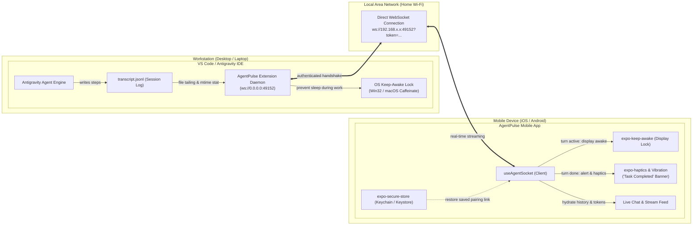

# AgentPulse VS Code Extension (`agentpulse-vscode`)

> VS Code & Antigravity IDE companion extension bridging your desktop AI sessions to your mobile phone over local Wi-Fi while AFK.

[](https://www.typescriptlang.org/)
[](https://code.visualstudio.com/)
[](https://opensource.org/licenses/MIT)
[](https://github.com/AnmolVerma404/AgentPulse-Mobile)

---

## 🔗 Sister Repository

* **Mobile Companion App:** [AgentPulse-Mobile (React Native / Expo)](https://github.com/AnmolVerma404/AgentPulse-Mobile)

---

## ⚡ Overview

When you run complex, multi-step agent prompts in **Google Antigravity**, you shouldn't have to stay glued to your desk. **AgentPulse** runs a lightweight local broadcast daemon inside your IDE that:

* **Tails Antigravity Transcripts:** Streams real-time tokens, internal reasoning, and tool calls directly from Antigravity's structured `%USERPROFILE%\.gemini\antigravity\brain\<id>\.system_generated\logs\transcript.jsonl` session logs.
* **Detects Task Completion:** Emits an instant `done` status event when the agent finishes its response turn.
* **Instant State Handshake (`INIT_SESSION`):** Automatically sends existing conversation history and current status to newly connected or reconnecting mobile clients so the chat screen populates immediately.
* **Local LAN Broadcast:** Automatically resolves your workstation's physical Wi-Fi/Ethernet IPv4 address (filtering out WSL/Docker virtual adapters) and generates a local pairing URI (`ws://192.168.x.x:49152?token=...`).
* **Prevents Laptop Sleep:** Engages OS-level keep-awake power assertions (Windows `SetThreadExecutionState` / macOS `caffeinate`) while an agent task is active.
* **Single Copy Command:** Provides `AgentPulse: Copy Connection URI` to copy your complete pairing link in 1 click.
* **Zero Cloud Storage & Privacy-First:** Runs 100% locally on your machine with ephemeral 256-bit token authentication (`crypto.randomBytes(32)` + `timingSafeEqual`). No chats or code are ever sent to an external database.

---

## 🤖 Supported AI Coding Assistants

| Assistant / Agent | IDE / Host | Support Status | Capabilities |
| :--- | :--- | :---: | :--- |
| **Google Antigravity** | Google Antigravity IDE |  **Supported** | Live thought streaming, tool execution indicators, history hydration, and completion alerts |
| **GitHub Copilot Chat** | VS Code | 🟡 *Planned* | Investigating VS Code Chat API session event listeners |
| **Cursor Agent** | Cursor | 🟡 *Planned* | Local session and transcript log tailing |
| **Claude Code** | Terminal / CLI | 🟡 *Planned* | Background terminal daemon observation |

---

## 📐 Architecture & Connection Flow



---

## 🛠️ Tech Stack

* **Platform:** VS Code Extension API (^1.93.0) + Antigravity IDE
* **Language:** TypeScript (Strict ES2022)
* **WebSocket Server:** `ws` bound to `0.0.0.0`
* **Security:** Cryptographic pairing tokens (`crypto.randomBytes(32)` + constant-time comparison)
* **Testing:** Jest + `ts-jest`

---

## 🚀 Getting Started

### Prerequisites
* Node.js 20+ installed
* VS Code or Google Antigravity IDE installed
* [AgentPulse-Mobile](https://github.com/AnmolVerma404/AgentPulse-Mobile) running on your phone connected to the same Wi-Fi router

### 1. Installation & Build
```bash
# Navigate to extension directory
cd extension

# Install dependencies
npm install

# Compile TypeScript
npm run compile

# (Optional) Package fresh .vsix extension file
npm run package
```

### 2. Running in Development (Extension Development Host)
1. Open the `extension/` folder in VS Code or Antigravity IDE.
2. Press <kbd>F5</kbd> to launch a new **Extension Development Host** window.
3. Open the Command Palette (<kbd>Ctrl</kbd>+<kbd>Shift</kbd>+<kbd>P</kbd> or <kbd>Cmd</kbd>+<kbd>Shift</kbd>+<kbd>P</kbd>) and run:
   * `AgentPulse: Start Mobile Companion Server`
   * `AgentPulse: Copy Connection URI` (or open the AgentPulse sidebar view)

---

## 🎮 Contributed Commands

| Command | Title | Description |
| :--- | :--- | :--- |
| `agentpulse.startServer` | `AgentPulse: Start Mobile Companion Server` | Starts the local WebSocket companion daemon on your LAN IP. |
| `agentpulse.showPairingQr` | `AgentPulse: Show Mobile Pairing QR Code` | Displays a pairing QR code and LAN URI in VS Code. |
| `agentpulse.copyConnectionUri` | `AgentPulse: Copy Connection URI` | Copies the full connection URI (`ws://192.168.x.x:49152?token=...`) to clipboard in one click. |
| `agentpulse.stopServer` | `AgentPulse: Stop Server` | Shuts down the daemon and releases keep-awake assertions. |

---

## 🧪 Testing & Quality Assurance

```bash
# Run Jest unit test suite (25 tests passing)
npm test

# Run TypeScript compile check
npm run compile
```

---

## 📁 Repository Structure

```
./
├── src/
│   ├── server/             # WebSocket daemon & network tools
│   │   ├── wss.ts          # Server instance & INIT_SESSION handshake
│   │   ├── auth.ts         # Token generation & constant-time verification
│   │   ├── network.ts      # Physical LAN IPv4 resolver
│   │   ├── sidebarView.ts  # Webview sidebar with QR code and status
│   │   └── qr.ts           # Terminal & webview QR code generation
│   ├── adapters/           # AI assistant observers
│   │   ├── base.ts         # AgentAdapter interface
│   │   ├── antigravity.ts  # Antigravity transcript tailing & history loader
│   │   └── copilot.ts      # GitHub Copilot Chat listener
│   ├── keepawake/          # Windows & macOS keep-awake engine
│   ├── extension.ts        # Extension activation and command registration
│   └── test/               # Jest test suite (25 tests)
├── package.json            # Extension manifest & commands
├── tsconfig.json           # TypeScript configuration
├── AGENTS.md               # Context cache for AI agents
└── plan.md                 # Development roadmap and step checklist
```

---

## 🔒 Security Architecture

* **LAN Binding with Ephemeral Secret:** Binds to `0.0.0.0` so mobile devices on the same Wi-Fi router can reach the server. Every pairing session creates an ephemeral 256-bit cryptographic token. Connections without this token are immediately rejected.
* **Read-Only Broadcast:** The extension does not accept code modification or shell command execution commands from the mobile client. It strictly streams agent status, thoughts, and logs.
* **Zero External Cloud:** No third-party servers, no relay telemetry, no external databases.
